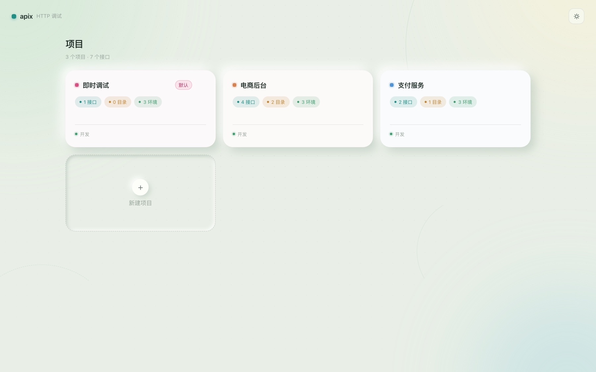
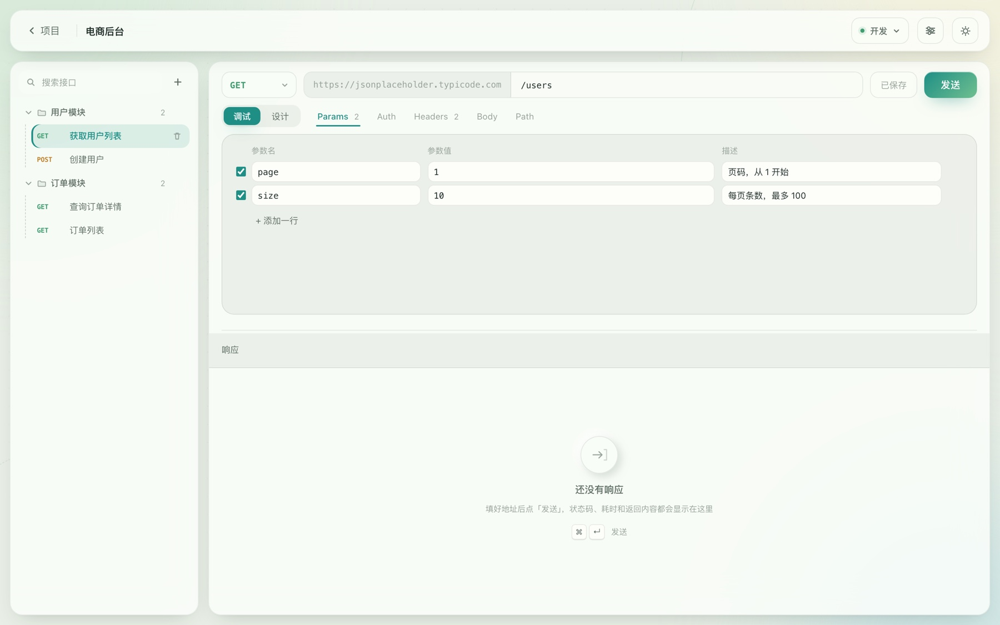
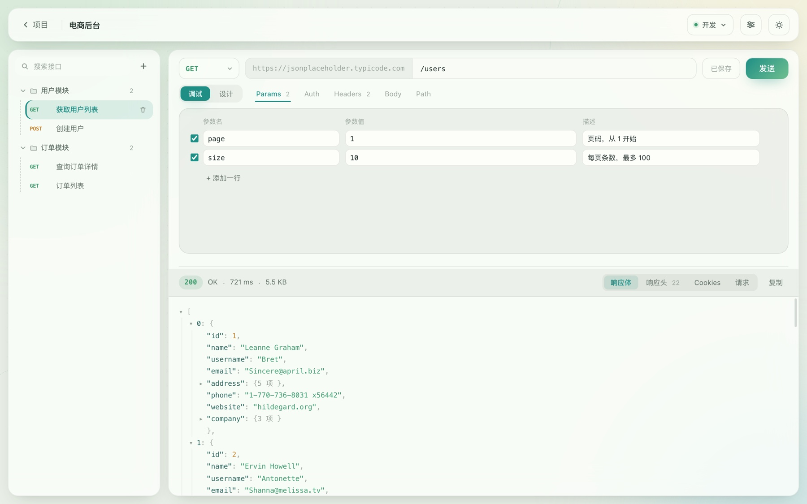
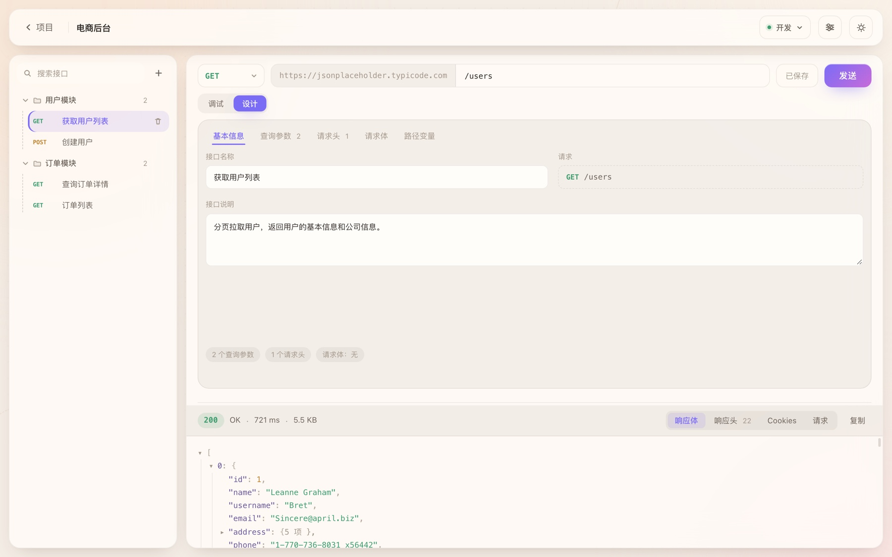
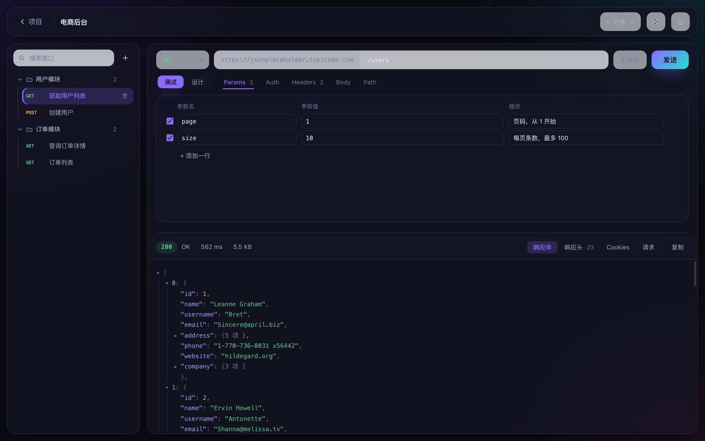
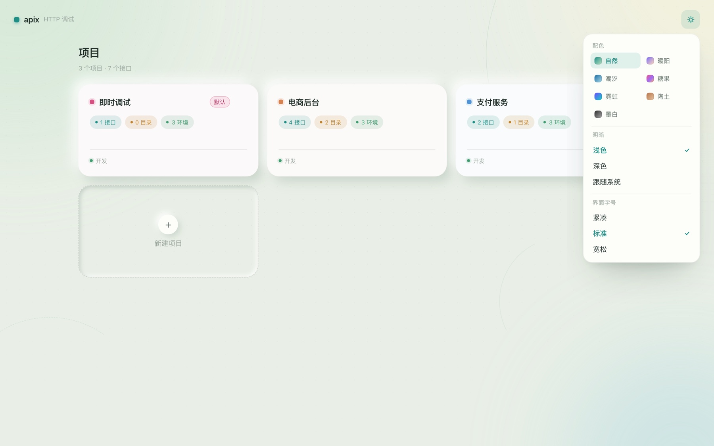

# apix

> 轻量的 HTTP 接口调试工具。打开即用，不用登录，数据全在本地。

按项目组织接口，目录可以嵌套；支持环境变量、全局参数、路径变量、鉴权、五种请求体。
桌面端用 Tauri 打包，冷启动很快，包体十几兆。

没有云同步，没有团队协作，也不需要登录——**它就是一个打开就能发的本地工具**。



## 目录

- [功能](#功能)
- [截图](#截图)
- [快速开始](#快速开始)
- [快捷键](#快捷键)
- [技术实现](#技术实现)
- [目录结构](#目录结构)
- [数据存在哪](#数据存在哪)
- [已知限制](#已知限制)
- [后续计划](#后续计划)

## 功能

**接口组织**

- 项目 → 目录（可无限嵌套）→ 接口，目录支持右键菜单和悬停加号
- 内置「即时调试」项目：不可删除、永远排在第一位，打开就能发请求
- 接口支持按名称搜索、双击重命名、右键删除

**请求**

- 七种常用方法（GET / POST / PUT / PATCH / DELETE / HEAD / OPTIONS），按语义配色
- 地址栏三段式：**方法 + 请求前缀 + 路径**。前缀配在环境上，接口里只写 `/users/1`
- 五个页签：**Params / Auth / Headers / Body / Path**，每个都带有效数量角标
- Params、Headers、Path、Body 字段都有「描述」列，调试和文档同一份数据
- Path 变量从地址里自动抽取：写 `/users/:id` 或 `/users/{id}` 就出现一行让你填值
- Auth 支持 Bearer / Basic / API Key（可放请求头或查询参数），底部实时显示"会带上什么"
- Body 五种类型：无 / JSON / 表单（multipart，可传文件）/ urlencoded / 纯文本
- JSON 支持**源码**和**键值表**两种编辑方式，切换时自动搬运内容
- 请求头三层继承：全局参数 → 环境参数 → 请求自己的，同名后者覆盖前者

**响应**

- 状态码 / 状态文本 / 耗时 / 大小
- 四个页签：响应体 / 响应头 / Cookies / **请求**（实际发出去的那条，含最终 URL 和请求头）
- JSON 自动渲染成可折叠的树，默认展开两层，点箭头收起
- Cookies 会解析 `Set-Cookie`，显示 domain、path、过期时间和 HttpOnly / Secure 标记

**工程化的小东西**

- 草稿 + 保存：编辑改的是副本，`⌘S` 或点「保存」才落库；切换接口会自动保存一次，不会丢改动
- 设计态：写接口名、说明和各字段描述，点「发送」自动切回调试
- curl / Postman / OpenAPI 导入导出：**暂未支持**，见[后续计划](#后续计划)

## 截图

**调试**：左边是目录树，中间是参数表，下面是响应



**响应**：状态码、耗时、大小一条线，下面是可折叠的 JSON 树



**设计**：同一个接口的文档视角，参数表、请求体结构和调试时是同一份数据



**深色**：深色不是把浅色反相，而是单独配的一套颜色



**配色**：七套配色 × 浅色/深色，随时切换



## 快速开始

> 需要 Node ≥ 18 和 pnpm；跑桌面端还需要 Rust ≥ 1.85。

```bash
pnpm install

pnpm dev          # 浏览器里跑，改代码热更新
pnpm tauri dev    # 桌面端（首次要编译 Rust，几分钟）
pnpm tauri build  # 打包，产物在 src-tauri/target/release/bundle
```

⚠️ 这两个命令都用 5173 端口（`strictPort`），**不要同时开**。

### 为什么浏览器里也能发请求

浏览器的同源策略会拦掉大部分跨域请求，也不允许改 `User-Agent`、`Cookie` 这类头。
所以开发时 `vite.config.ts` 里挂了一个本地代理 `/__proxy`：前端把「要发的请求」交给 dev server 的 Node 进程去发，再把结果原样返回。

**这只是开发期的权宜之计**。装成桌面端后，请求由 Rust 侧发出，不受任何浏览器限制。

## 快捷键

| 快捷键 | 作用 |
| --- | --- |
| `⌘ / Ctrl + Enter` | 发送请求 |
| `⌘ / Ctrl + S` | 保存当前接口 |
| `Enter`（地址栏里） | 发送请求 |
| `Tab`（代码编辑器里） | 插入两个空格，不跳出输入框 |
| `Esc` | 关闭弹窗 / 取消重命名 |

## 技术实现

| 层 | 选择 | 为什么 |
| --- | --- | --- |
| 壳 | Tauri 2 | 包体约 10MB，冷启动快，体积比 Electron 小一个量级 |
| 前端 | Vue 3 + TypeScript + Vite | 模板写表单快，类型能兜住数据结构的迁移 |
| 状态 | 一个 `reactive` 对象 + localStorage | 没有后端，不需要 Pinia 那一套 |
| HTTP | **Rust 侧 reqwest** | 见下 |
| 高亮 | 自己写的 CodeEditor | 见下 |

几个当时想清楚的决定：

**请求必须走 Rust。** 前端 `fetch` 受 CORS 限制、改不了 UA、关不掉证书校验、设不了代理——这几点正好是调试工具的命门。所以前端只负责拼参数，`invoke('send_request', payload)` 交给 reqwest 发。

**语法高亮没引 CodeMirror。** 做法是底下铺一层高亮的 `<pre>`，上面盖一个背景透明的 textarea，两边滚动同步。三十行代码，零依赖，包体不受影响。哪天需要行号、折叠、多光标再换。

**数据只有两层半。** 项目 → 目录/接口，参数、请求头、Body 全部塞 JSON 列，只有需要排序和搜索的字段才拆列。这样改一次 Body 结构不用迁移数据库。

**主题是 CSS 变量的三个维度。** 明暗（`data-theme`）× 配色（`data-palette`）× 字号（`data-size`），组件里不写死颜色和尺寸。换主题只改 `styles.css` 顶部的变量，一行组件代码都不用动。

## 目录结构

```
src/
├── App.vue                 应用外壳：两个页面 + 上下分栏
├── types.ts                全部数据类型
├── styles.css              设计变量（颜色/圆角/字号）+ 七套配色
├── main.ts                 入口
├── api/
│   ├── http.ts             发送入口：桌面端走 Rust，浏览器走本地代理
│   └── body.ts             键值表 ⇄ JSON 互转
├── store/
│   ├── workspace.ts        本地数据层：读写、增删项目/目录/接口/环境
│   ├── draft.ts            接口草稿：编辑副本，保存才落库
│   ├── theme.ts            外观：明暗 / 配色 / 字号
│   ├── fileCache.ts        上传文件的内存缓存（不落盘）
│   ├── contextMenu.ts      全局右键菜单状态
│   └── confirm.ts          自绘确认框
└── components/
    ├── ProjectList.vue     首页项目宫格
    ├── TopBar.vue          顶栏：返回 / 环境切换 / 设置 / 外观
    ├── Sidebar.vue         左侧接口树
    ├── FolderNode.vue      目录节点（递归）
    ├── RequestItem.vue     接口节点
    ├── RequestEditor.vue   请求区：调试/设计 + 五个页签
    ├── DesignPanel.vue     设计态
    ├── AuthEditor.vue      鉴权
    ├── BodyEditor.vue      请求体
    ├── PathEditor.vue      路径变量
    ├── KeyValueEditor.vue  键值表格（参数/请求头/变量共用）
    ├── FormEditor.vue      表单（multipart，支持文件）
    ├── CodeEditor.vue      语法高亮编辑器
    ├── ResponsePanel.vue   响应区
    ├── JsonView.vue        JSON 树
    ├── JsonNode.vue        递归节点
    ├── SettingsDialog.vue  环境参数与变量
    ├── AppearanceMenu.vue  外观菜单
    ├── MethodSelect.vue    方法下拉
    ├── EnvSelect.vue       环境下拉
    ├── ContextMenu.vue     右键菜单
    └── ConfirmDialog.vue   确认框
src-tauri/
└── src/main.rs             桌面端入口 + send_request 命令（reqwest）
```

前端约 8000 行（含注释和样式），Rust 侧 168 行。全部中文注释。

## 数据存在哪

- **项目、目录、接口、环境、变量**：`localStorage`，键名 `apix.workspace.v2`，改完 250ms 防抖落盘，没有"保存文件"的概念
- **草稿**：内存里的副本，`⌘S` 才写回上面那份
- **上传的文件**：只在内存（`store/fileCache.ts`）——localStorage 只有 5MB，而且每次改动都要重新序列化整个数据包，塞进去会让编辑变卡。**代价是刷新页面后要重新选文件**，界面上会提示

## 已知限制

- 表单里的文件不落盘，刷新后需要重新选择
- 没有历史记录、Mock 服务、自动化测试、团队协作
- 暂无导入导出（curl / Postman / OpenAPI 都还没做）
- 大文件走 base64 经 IPC 传给 Rust，几十 MB 会有明显延迟；真要传大文件应该改成传路径让 Rust 直接读盘
- 多个窗口之间不会同步数据（各自持有内存副本，后写覆盖先写）

## 后续计划

按优先级排：

1. **导入导出**：curl、Postman v2.1、OpenAPI 3、HAR
2. **历史记录**：回放、一键存为接口
3. **代码生成**：curl / fetch / axios / Python / Go
4. 目录拖拽排序、请求多标签页、`⌘K` 命令面板
5. Mock 服务、自动化测试

## 版本

`v1.0.0` —— 第一个可用的版本，日常接口调试够用了。

## 许可

还没选开源协议。如果要正式对外用，建议先加一个（MIT 或 Apache-2.0 都合适）。
